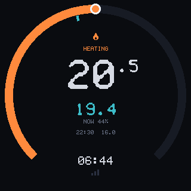
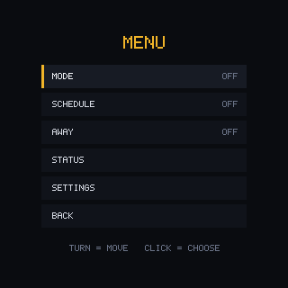
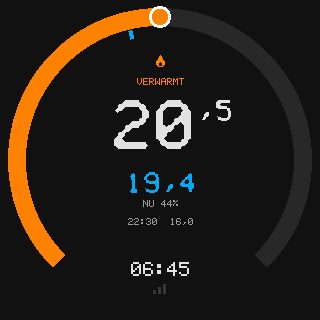
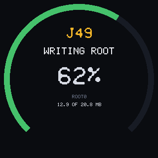

# J49: our own software on a Nest Learning Thermostat (2nd generation)

A second-generation Nest thermostat (board name J49: TI OMAP3630, 64 MB RAM, round 320x320 panel)
that runs a current Linux and our own thermostat software instead of the stock firmware. No cloud:
it controls the heating by itself, and it is reached over the home network.

> [!CAUTION]
> ## Not ready for production: on a backplate the battery runs empty
>
> **Do not put this on the thermostat that heats your house.** State on 28 November 2026:
>
> - **The battery runs empty within about a night** when the thermostat sits on its backplate.
>   The backplate supplies less than the head unit uses, and our sleep does not make up for it.
>   When the battery is empty the thermostat goes off, and the heating with it.
> - **Sleeping is not reliable.** After some wake-ups the thermostat loses WiFi and stays
>   unreachable until it restarts.
> - The stock firmware has neither problem. A backup made with the installer brings it back.
>
> It is fit for experiments, and for a thermostat on a USB supply. Work on this is going on:
> [what is known](docs/sleep-j49.md).

<p>




</p>

> **Before you use this:** it replaces the firmware of your thermostat and switches real heating.
> It is a hobby project without warranty and it is not affiliated with Google or Nest. Read the
> [disclaimer](DISCLAIMER.md) first.

## What it does

| | |
|---|---|
| **Heating** | Reads temperature, humidity, motion and light from the backplate and switches the Heat Link through it. Hysteresis, minimum on/off times (boiler or valve), frost protection, a week schedule, away mode. |
| **Screen** | A dial like the thermostat card of Home Assistant: target and room temperature, what the heating does, clock, WiFi. The ring sets the temperature; a click opens a menu for mode, schedule, away, status and settings. English or Dutch. |
| **Web page** | `http://<device>/`: temperature, away, schedule editor, MQTT broker, WiFi networks, device settings. Login has no password: the browser shows a code and somebody confirms it on the device with the ring. |
| **Home Assistant** | MQTT with discovery: a climate entity, sensors, the schedule per day and as JSON, away, volume, brightness, sleep state, tunes on the piezo. |
| **Sleep** | Suspends when idle. The backplate wakes it (timer, temperature, motion); the WiFi chip wakes it for MQTT, the web page and SSH. On unless switched off. |

Heating is off until it is switched on (`mode=off`). Sleeping is on unless it is switched off.

## Status

**Not ready for production: see the warning at the top.** The battery on a backplate and the
sleep are the open problems; [docs/sleep-j49.md](docs/sleep-j49.md) says what is known and what
is being tried.

Works on the device: everything in the table above, the installer, and updates over USB (DFU)
without opening anything. It hangs on a real backplate and controls real heating since
27 November 2026.

Open or not verified: how long it can sleep and what that saves (two power domains do not reach
retention), a kernel panic when the backplate serial port is reopened in one specific situation,
the 802.15.4 radio (it runs Nest's own stack, not Thread or Zigbee; only explored), and long
runs in general. Each document below says what was checked and what was not.

## The parts

| Program | Role | Details |
|---|---|---|
| `bpd` | Talks to the backplate over the serial line; the thermostat control loop | [thermostat](docs/thermostat.md), [protocol](docs/backplate-protocol.md), [Heat Link](docs/backplate-heatlink-flow.md) |
| `j49-screen` | The panel, the ring, the piezo | [thermostat](docs/thermostat.md) |
| `j49-web` | Web page on port 80 | [thermostat](docs/thermostat.md#web-page-j49-web) |
| `j49-mqtt` | MQTT and Home Assistant discovery | [thermostat](docs/thermostat.md#home-assistant-j49-mqtt), [cards](docs/home-assistant.md) |
| `j49-sleep` | Decides when to suspend | [sleep](docs/sleep-j49.md) |
| `j49-wifi` | Opens a WiFi hotspot for setup when there is no network | [thermostat](docs/thermostat.md#wifi-setup-hotspot-j49-wifi) |
| `j49-dfu` | Reboots into the U-Boot download mode | [updating](tools/dfu-install/update-from-linux.md) |

They are small Rust programs without a framework, and they do not call each other. The interface
is a handful of text files: settings in `/var/lib/j49/` (`thermostat`, `schedule`, `mqtt.conf`,
`sleep`), state in `/run/` (`/run/bpd/heat`, `/run/bpd/sht20`, ...). `bpd` is the only one that
decides about heat; the others read state and write settings. The formats are in
[docs/thermostat.md](docs/thermostat.md).

## Build

On NixOS (or anything with Nix and Docker). The flake provides `kas`, the cross compilers and a
Rust toolchain; the Yocto build runs in the official container.

```bash
nix develop

# the whole image (kernel 6.6.64, systemd, all programs): build/tmp/deploy/images/nest-j49/
env KAS_CONTAINER_ENGINE=docker kas-container build kas/nest-j49.yml

# one program, static, to copy onto a running device
cd tools/bpd && cargo build --release --target armv7-unknown-linux-musleabihf

# its unit tests, on the PC
cargo test --release --target x86_64-unknown-linux-gnu
```

Yocto release: blacksail. Layers: openembedded-core, meta-yocto, meta-openembedded and `meta-j49`.

## Install and update

- **First install on a stock Nest:** [docs/install.md](docs/install.md). An installer page in the
  browser (Chrome or Edge, over USB) makes a full backup, writes the boot loader and installs
  the system; it can also put the backup back. The same steps with command-line tools are in
  [tools/dfu-install/README.md](tools/dfu-install/README.md).
- **Update a running device:** [tools/dfu-install/update-from-linux.md](tools/dfu-install/update-from-linux.md).
  A new root filesystem goes to the other slot over WiFi; the kernel is written over USB, without
  the ring gesture. When the kernel stays the same, the files that differ can be copied over WiFi.
- **What a new root filesystem must get back:** the WiFi configuration and the calibration file
  with the MAC address (kept on the scratch partition and restored at boot), and the settings in
  `/var/lib/j49` and `/var/lib/j49-screen`.

## Use

- **On the device:** turn the ring for the temperature. Click for the menu, turn to a row, click
  to change it or open it.
- **Web page:** open the address of the device, choose "Log in", confirm the code on the device.
  Plain HTTP, for the home network only.
- **Home Assistant:** fill in the broker on the web page; the device then appears by itself.
- **SSH:** `ssh root@<device>`. `journalctl -u bpd` shows what the thermostat does,
  `j49-sleep status` whether and why it is awake.

The screen and the web page speak English or Dutch and have four themes (default, Home Assistant dark and
light, light); both are chosen under Settings on the device or on the web page, and the names of the
entities in Home Assistant follow the language. Languages and themes are plain text files in
`tools/lang` and `tools/themes`: see
[docs/thermostat.md](docs/thermostat.md#languages-locale-and-themes).

## Repository

```
meta-j49/            the Yocto layer: machine nest-j49, kernel and U-Boot patches, image, recipes
kas/                 the build configuration
tools/bpd            backplate daemon and thermostat control
tools/j49-screen     display, ring, sound
tools/j49-web        web page
tools/j49-mqtt       MQTT / Home Assistant
tools/j49-sleep      sleep manager
tools/j49-wifi       WiFi setup hotspot
tools/j49-dfu        reboot into DFU
tools/j49-ncp        read-only tool for the 802.15.4 radio's bootloader
tools/lang          texts per language (screen and web page)
tools/themes        colours and style
tools/dfu-install    U-Boot, installer, install and update scripts
tools/web-installer  the installer page (WebUSB)
tools/sleep-test     scripts used to test suspend and wake-up
tools/nlclient-mitm  running stock nlclient in a chroot to capture its backplate traffic
docs/                see below
```

## Documentation

| Document | About |
|---|---|
| [docs/install.md](docs/install.md) | Installation guide: install, backup, back to stock |
| [docs/thermostat.md](docs/thermostat.md) | Settings and state files, the control loop, the screen, the web page, MQTT topics |
| [docs/home-assistant.md](docs/home-assistant.md) | Entities and dashboard cards |
| [docs/backplate-protocol.md](docs/backplate-protocol.md) | Serial protocol of the backplate, handshake, sensor frames |
| [docs/backplate-heatlink-flow.md](docs/backplate-heatlink-flow.md) | How heat is switched, from stock nlclient and the backplate firmware |
| [docs/sleep-j49.md](docs/sleep-j49.md) | Suspend, the backplate's quiet mode, wake-on-WLAN, the sleep manager |
| [docs/sleep-stock.md](docs/sleep-stock.md) | How the stock firmware sleeps |
| [docs/em357-radio.md](docs/em357-radio.md) | The 802.15.4 radio and its bootloader |
| [docs/flash-layout.md](docs/flash-layout.md) | NAND partitions |
| [docs/modernization-plan.md](docs/modernization-plan.md) | Hardware profile and the original roadmap |
| [docs/hw/](docs/hw) | Notes taken from the stock system: clocks, GPIO, pin mux |
| [CHANGELOG.md](CHANGELOG.md) | Early history of the bring-up (until 23 November 2026); after that the git log |

## Credits and contributing

The way into the thermostat was found by GTVHacker and is kept alive by the cuckoo-nest
project; the full list is in [CREDITS.md](CREDITS.md). How to contribute:
[CONTRIBUTING.md](CONTRIBUTING.md).

## Licence

Our own code and documentation: [MIT](LICENSE). Patches for the Linux kernel and U-Boot follow the
licences of those projects (GPL-2.0). See the [disclaimer](DISCLAIMER.md).

## Good to know

- No secrets are in this repository. WiFi and broker credentials live on the device only.
- The full backup of the stock firmware is kept outside git. The five images the installer uses
  are in the repository as they were in the last release: the two loaders of the USB boot chain,
  the service kernel, our kernel and our U-Boot
  ([who made them, licences, sources](tools/web-installer/images-notice.md)).
- This is a hobby project on one model of thermostat. It switches real heating: read
  [docs/backplate-heatlink-flow.md](docs/backplate-heatlink-flow.md) before trusting it with yours.
